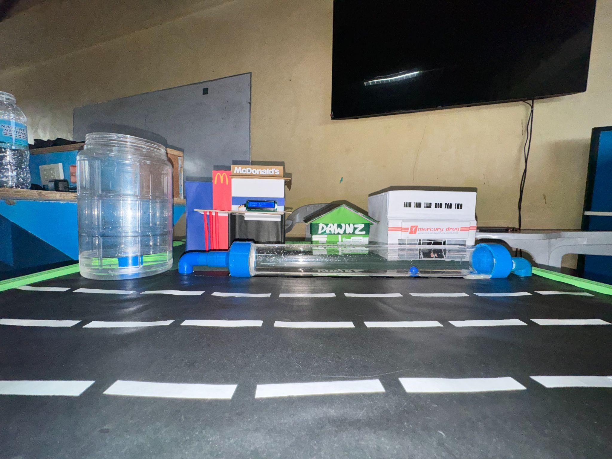

# AquaFlush

Arduino-based water-flow monitoring for a miniature urban drainage model.

This is Phoebien D. Cañete's independent portfolio and documentation edition of a group academic project developed for BCA144 at MSU-Iligan Institute of Technology in May 2025.

## Source and attribution

Original team repository: [ShaniceReih/AquaFlush-Water-Flow-Monitoring](https://github.com/ShaniceReih/AquaFlush-Water-Flow-Monitoring).

See [Attribution](docs/ATTRIBUTION.md) for all five team members and the preserved project materials.

## Recovered firmware

The unchanged [Arduino sketch](firmware/AquaFlush_Original_Recovered/AquaFlush_Original_Recovered.ino) counts flow-sensor pulses and displays an estimated flow reading. Its containing folder is named for use with Arduino IDE.
