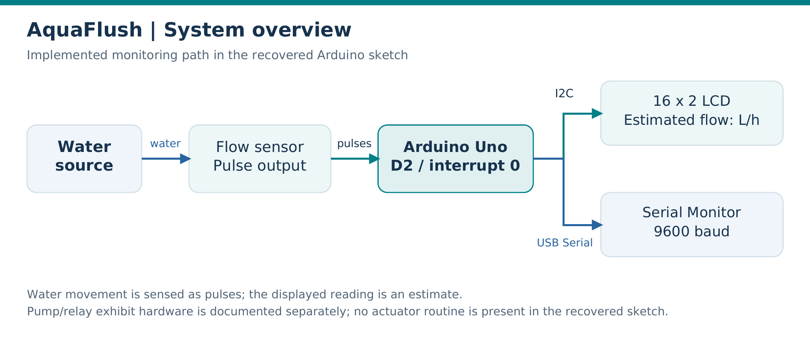

# AquaFlush

**Arduino-based water-flow monitoring for a miniature urban drainage model.**

[Technical report](docs/AquaFlush-Lab-Report.pdf) · [Hardware](docs/HARDWARE.md) · [Setup](docs/SETUP.md) · [Firmware](docs/FIRMWARE.md) · [Gallery](docs/PHOTO_GALLERY.md)

AquaFlush uses an Arduino Uno to count water-flow sensor pulses, estimate flow in liters per hour, and display the reading on a 16×2 I²C LCD and Serial Monitor. The electronics are integrated into a miniature roadway and drainage model inspired by drainage concerns in Barangay Tibanga, Iligan City.

This is **Phoebien D. Cañete's independent portfolio and documentation edition** of a group academic project developed for BCA144 at MSU-Iligan Institute of Technology in May 2025. The [original team repository](https://github.com/ShaniceReih/AquaFlush-Water-Flow-Monitoring) and all team credits are retained in [Attribution](docs/ATTRIBUTION.md).

## Project at a glance

| Item | Details |
|---|---|
| Platform | Arduino Uno / ATmega328P |
| Language | Arduino C/C++ |
| Sensor | Pulse-output water-flow sensor; exact model unconfirmed |
| Display | 16×2 I²C LCD; code assumes address `0x27` |
| Output | Estimated L/hour on the LCD and Serial Monitor |
| Update interval | Approximately one second |
| Serial rate | 9600 baud |
| Status | Historical academic prototype with recovered firmware |

## Implemented features

- Acquire rising-edge sensor pulses using an external interrupt on D2.
- Convert the pulse count into an estimated whole-number flow value.
- Present flow readings through an I²C LCD and Serial output.
- Integrate the monitoring electronics into a physical drainage demonstration model.

The recovered source implements local monitoring. Automatic pump response, obstruction classification, and internet telemetry remain proposed extensions. See [Project scope](docs/PROJECT_SCOPE.md) for implementation boundaries and source provenance.

## How it works

The sensor produces pulses as water moves through it. The Arduino counts those pulses and updates the display roughly once per second. The conversion uses a divisor of `7.5`; its suitability for the unidentified sensor and the resulting measurement accuracy remain unverified. The [firmware guide](docs/FIRMWARE.md) explains the calculation and known implementation limitations.

## Getting started

1. Download or clone this repository.
2. Open [`firmware/AquaFlush_Original_Recovered/AquaFlush_Original_Recovered.ino`](firmware/AquaFlush_Original_Recovered/AquaFlush_Original_Recovered.ino) in Arduino IDE.
3. Select **Arduino Uno** using the **Arduino AVR Boards** platform.
4. Install a compatible `LiquidCrystal_I2C` library as described in [Setup](docs/SETUP.md).
5. Use **Verify** to check compilation. Hardware reuse additionally requires confirming module ratings, wiring, the LCD address, and the board port.

Source review does not require reconnecting the prototype. This documentation edition includes no additional physical trials or fresh build-validation claim.

## Documentation

| Resource | Contents |
|---|---|
| [Technical report](docs/AquaFlush-Lab-Report.pdf) | Illustrated six-page project report |
| [Hardware](docs/HARDWARE.md) | Component list, pin map, and reference wiring diagram |
| [Setup](docs/SETUP.md) | Dependencies, IDE steps, configuration, and output format |
| [Firmware](docs/FIRMWARE.md) | Execution flow, conversion method, and source limitations |
| [Troubleshooting](docs/TROUBLESHOOTING.md) | Checks for opening or reusing the project |
| [Photo gallery](docs/PHOTO_GALLERY.md) | Five original photographs and their captions |
| [Project scope](docs/PROJECT_SCOPE.md) | Implemented functions, provenance, and future development |
| [Attribution](docs/ATTRIBUTION.md) | Original project, team credits, and this independent edition |
| [References](docs/REFERENCES.md) | Project materials and primary technical sources |
| [Revision notes](CHANGELOG.md) | Documentation changes |

## Prototype details

| Electronics and wiring | LCD during the demonstration |
|---|---|
|  |  |

The LCD photo includes a pump-status label absent from the recovered source. The [gallery](docs/PHOTO_GALLERY.md) records this unresolved difference without attributing undocumented actuation to the sketch.

## Team and contributions

| Team member | Contribution recorded in the project documentation |
|---|---|
| **Phoebien D. Cañete** | Arduino programming, electronics wiring, and prototype construction; maintainer of this portfolio edition |
| Dja-ver Q. Hassan | Arduino programming, circuit wiring, and prototype construction |
| Tristan E. Listanco | Arduino programming, circuit wiring, and prototype construction |
| Mary Grace V. Soronio | Arduino programming, circuit wiring, and prototype construction |
| Shanice Reih H. Tanque | Arduino programming, circuit wiring, and prototype construction |

The recovered firmware is preserved unchanged. This edition reorganizes the project files and expands the documentation, diagrams, and technical explanations. See the [attribution record](docs/ATTRIBUTION.md) for the original source and group context.

