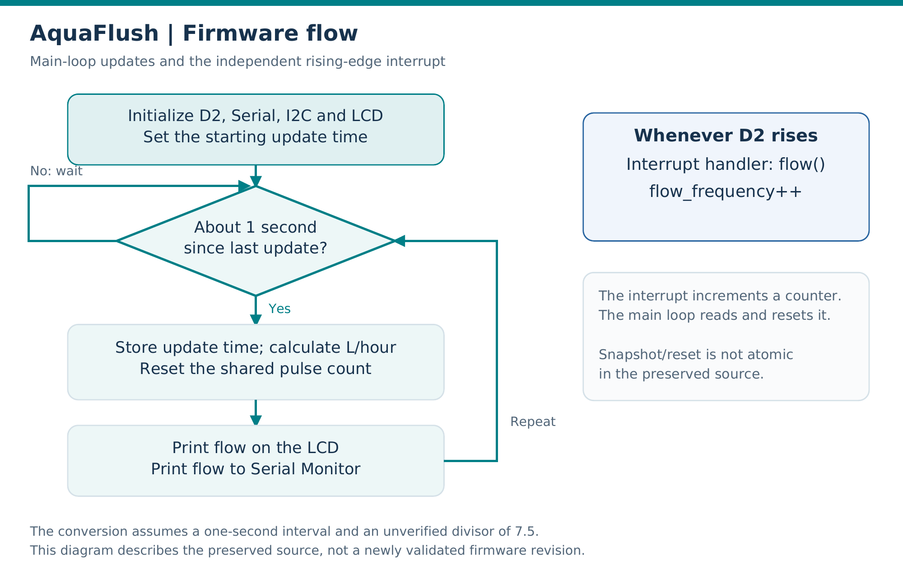

# Firmware and measurement notes

[Back to project overview](../README.md)

## Source files

- [Recovered sketch in its Arduino-compatible folder](../firmware/AquaFlush_Original_Recovered/AquaFlush_Original_Recovered.ino)

The source is a reconstruction from a presentation screenshot, according to the supplied documentation. It is preserved without firmware changes in a folder that matches Arduino's sketch naming requirement.

## Program flow



The interrupt handler and main loop have separate responsibilities:

| Part | Responsibility |
|---|---|
| `setup()` | Configure D2 and its pull-up, start Serial, attach a rising-edge interrupt, initialize I²C/LCD, and store the starting time |
| `flow()` interrupt handler | Increment `flow_frequency` when a rising pulse arrives |
| `loop()` | Wait for the update condition, calculate estimated L/hour, reset the pulse count, and print the outputs |

The code explicitly enables interrupts using `sei()`, which is AVR-specific. This is one reason the documented target remains the Uno/ATmega328P rather than an unspecified Arduino-compatible board.

## Measurement relationship

Let `N` be the counted pulses, `Δt` the measurement interval in seconds, and `k` the sensor factor in Hz per L/min. Then:

- Pulse frequency: `f = N / Δt` Hz
- Estimated flow: `Q = 60 × f / k` L/hour

The recovered code uses `k = 7.5` and treats an approximately one-second pulse count as `f`:

```cpp
l_hour = (flow_frequency * 60 / 7.5);
```

The code therefore assumes the sensor relationship `f = 7.5 × Q`, where `Q` is in L/min. The exact sensor model and a sensor-specific calibration record are unavailable. The comment naming an S201-type sensor does not independently identify the physical module.

`l_hour` is an unsigned integer, so fractional flow values are discarded. LCD and Serial text describe the resulting whole-number estimate.

## Known implementation limitations

| Detail in the preserved source | Consequence |
|---|---|
| Uses a fixed one-second assumption rather than measured elapsed time in the conversion | Timing delays can change the relation between count and actual frequency |
| Reads and resets a shared interrupt counter without an atomic snapshot | A pulse can arrive during access; 16-bit access on an 8-bit AVR also has a race risk |
| Stores the counter in a signed `int` and multiplies before floating-point division | Large counts can exceed the integer arithmetic range |
| Uses `currentTime >= cloopTime + 1000` | This comparison does not handle the `millis()` rollover robustly |
| Uses an assumed conversion factor | Accuracy for the exhibited sensor is not established |
| Has no actuator, threshold, or network routines | Pump automation, blockage classification, and telemetry are outside this implementation |

These notes explain the archived implementation. No fixes, new measurements, or successful build claims are introduced by this documentation update.

