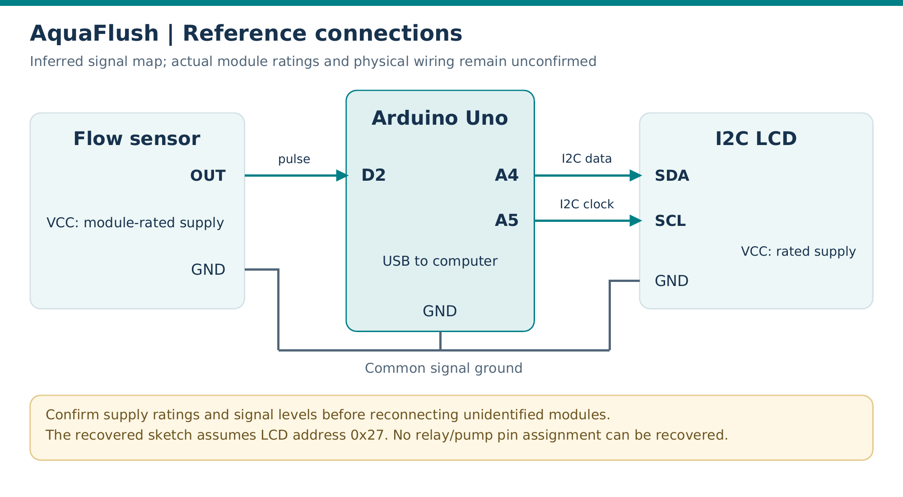

# Hardware and reference wiring

[Back to project overview](../README.md)

## Reference wiring diagram

This is a **reference connection diagram**, not a verified reconstruction of the complete 2025 circuit. Signal assignments come from the recovered sketch and the official Arduino Uno pinout. Module supply ratings, wire colors, and the exact sensor model have not been confirmed.

| Module connection | Arduino Uno connection | Basis |
|---|---|---|
| Flow-sensor pulse output | D2 / external interrupt 0 | `flowsensor = 2` and `attachInterrupt(0, flow, RISING)` |
| LCD SDA | A4 / SDA | Standard Uno I²C assignment |
| LCD SCL | A5 / SCL | Standard Uno I²C assignment |
| Compatible sensor/LCD ground | GND / shared signal reference | Reference connection; verify actual modules |
| Sensor supply | Supply matching the confirmed sensor rating | Exact module rating not recorded |
| LCD/backpack supply | Supply matching the confirmed module rating | Exact module rating not recorded |
| Computer connection | USB | Source upload and Serial Monitor |

The sketch uses LCD address `0x27`. A different backpack address would require an adjustment in a working copy of the sketch. Check signal voltage compatibility with the Uno before reconnecting an unidentified sensor.

## Bill of materials

Quantities below describe the documented prototype or a single-module monitoring setup. Exact part numbers and original costs were not retained; no price estimates have been invented.

| Component | Quantity | Specification or identification | Purpose |
|---|---|---|---|
| Arduino Uno | 1 | ATmega328P platform | Pulse acquisition and display updates |
| Water-flow sensor | 1 | Pulse-output type; exact model unconfirmed | Produces pulses as water passes through it |
| LCD with I²C backpack | 1 | 16×2 characters; code assumes `0x27` | Local flow display |
| Breadboard | 1 visible | Rating/model not recorded | Prototype connections |
| Jumper wires | Set | Count not recorded | Signal and power wiring |
| Relay module | 1 shown/listed | Identified as 5 V in supplied documentation | Exhibit hardware; no control code recovered |
| Water pump | 1 shown | Voltage/current/model not recorded | Exhibit water circulation hardware |
| Water container and tubing | Set | Dimensions not recorded | Physical water path |
| Miniature roadway/drainage model | 1 | Team-built model | Demonstration environment |
| USB data cable | 1 for reuse | Compatible with the particular Uno board | Upload and Serial access |

## Pump and relay boundaries

There is no relay output pin, pump timing, or actuator-control routine in the recovered sketch. A reliable pump-control wiring map cannot be reconstructed from that code. The reference diagram therefore documents the monitoring connections only.

## Power and water handling

For any future physical reuse, confirm the actual module and pump ratings before wiring. A pump requires an appropriately rated supply and switching/protection arrangement; an Arduino GPIO is not a pump supply. Keep the electronics dry and supported away from the water path. The historical exhibit photographs are documentation, not a validated electrical installation guide.

## Sources

- [Recovered firmware](../firmware/AquaFlush_Original_Recovered/AquaFlush_Original_Recovered.ino)
- [Original photographs](PHOTO_GALLERY.md)
- [Arduino Uno full pinout](https://docs.arduino.cc/resources/pinouts/A000066-full-pinout.pdf)
- [Source and evidence notes](PROJECT_SCOPE.md)

