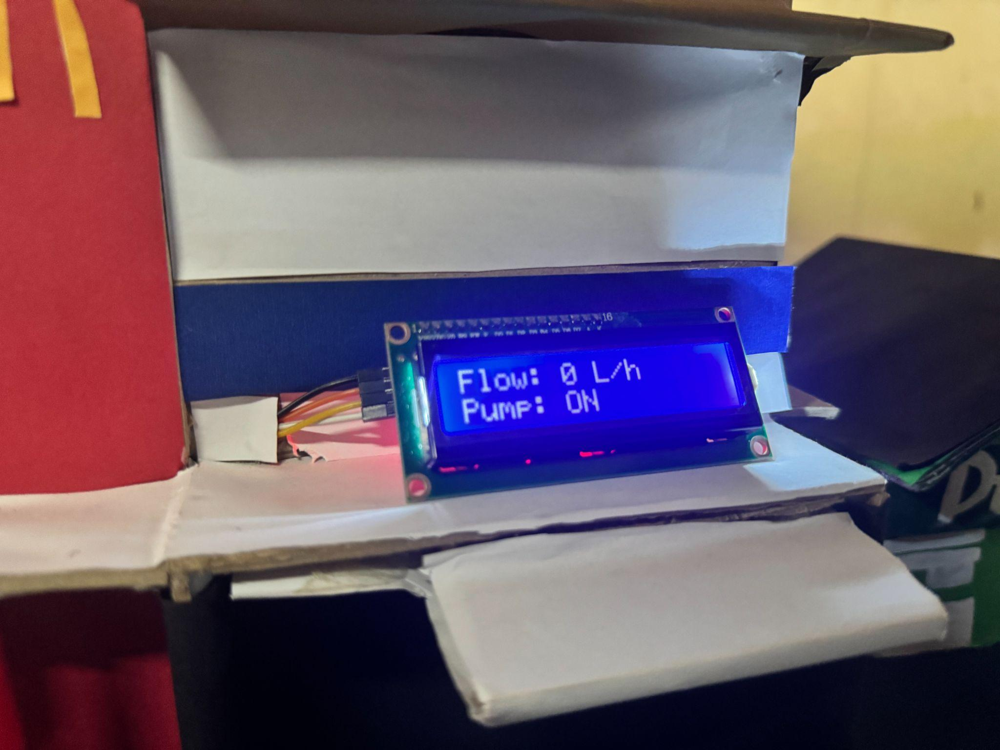
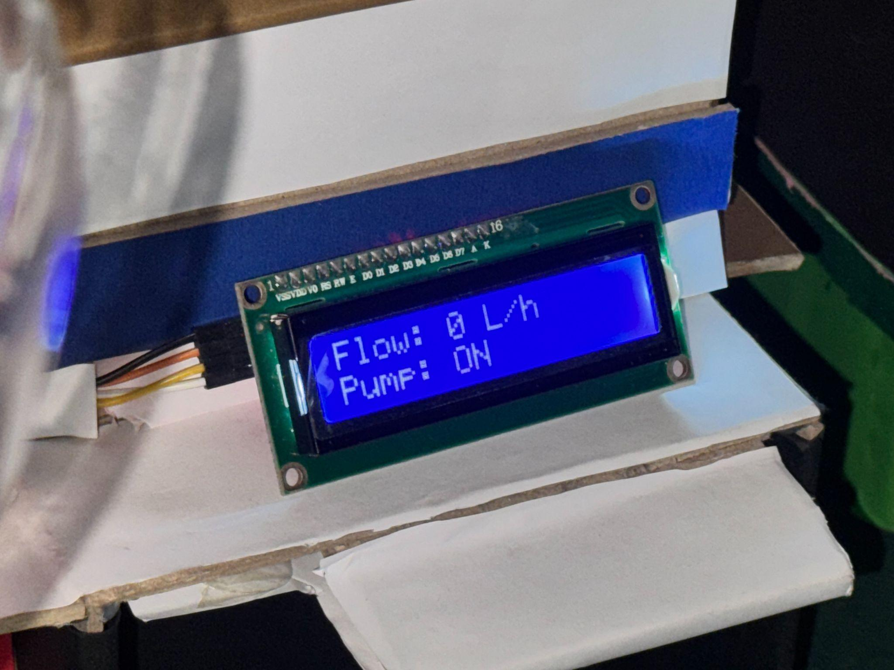
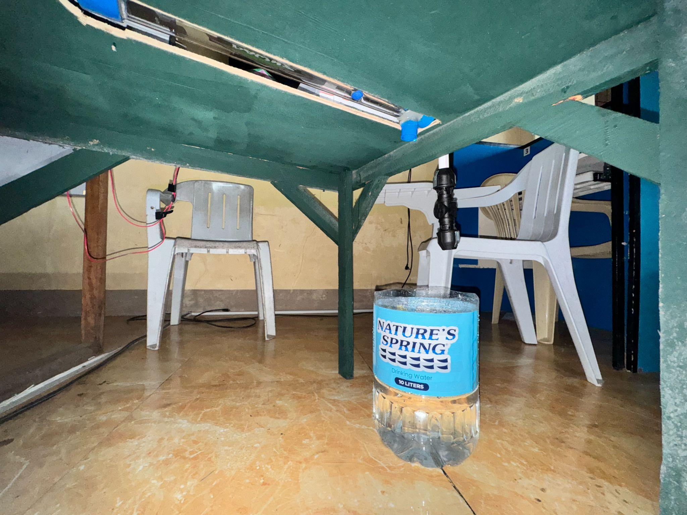

# Prototype photo gallery

[Back to project overview](../README.md)

The five photographs below are retained from the supplied archive. Its photo catalog attributes them to slides 6-7 of the team's May 2025 presentation. The presentation itself is not included in the archive. The photographs have not been regenerated or used to invent additional hardware details.

## 1. Complete drainage model

**Figure 1.** Miniature roadway and drainage model with a water container, piping, and mounted display. Original catalog: presentation slide 7.

## 2. Electronics and wiring

**Figure 2.** Electronics mounted inside the exhibit, including a breadboard and relay module. The photograph does not establish a complete circuit pin map. Original catalog: slide 6.

## 3. Display placement

**Figure 3.** Front-facing LCD placement within the scale model. Original catalog: slide 6.

## 4. LCD close-up

**Figure 4.** LCD photographed displaying a flow value and a pump-status label. Original catalog: slide 7.

**Source note:** The recovered sketch contains neither the second-row pump-status text nor pump-control logic. This photograph records what was displayed at the exhibit; the available files do not resolve its difference from the recovered firmware.

## 5. Water container and circulation hardware

**Figure 5.** Container and pump/hose arrangement documented beneath the exhibit. Exact pump ratings and wiring are not recorded. Original catalog: slide 6.

## File catalog

| Image | Description | Cataloged slide |
|---|---|---|
| `drainage-prototype-overview.jpg` | Complete miniature model | 7 |
| `arduino-wiring-and-relay.jpg` | Electronics and wiring | 6 |
| `lcd-display-overview.jpg` | Mounted LCD | 6 |
| `lcd-display-closeup.jpg` | LCD with flow and pump-status label | 7 |
| `pump-and-water-container.jpg` | Water container and circulation hardware | 6 |

